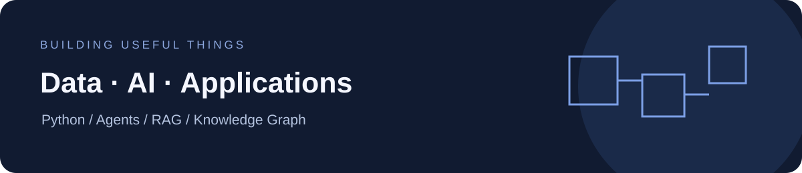

# 你好，我是 mikasa 👋

关注 **Python 开发、AI Agent 与大模型应用**，喜欢探索智能体和多 Agent 协作，把大模型、数据和知识检索结合起来，做成可以实际使用的工具。长春理工大学信息安全专业，2027 届；目前关注杭州的 Python 与 AI 应用开发机会。

## 我在探索

- **AI Agent 与数据工程**：自然语言转 SQL、数据库探索和工作流编排。
- **知识库与 RAG**：文档解析、向量检索、知识图谱和大模型问答。
- **应用开发**：使用 Python 和 Java 构建后端服务，关注前后端联调与应用落地。

## 代表项目

| 项目 | 简介 | 关注点 |
| --- | --- | --- |
| [Data Engineer](https://github.com/Huangbingshuai/data_engineer) | 用自然语言探索数据库，支持 SQL 工作流和数据分析。 | NL2SQL · Agent · Python |
| [多 Agent 知识库](https://github.com/Huangbingshuai/com_agent_chat) | 结合文档解析、知识图谱与向量检索的知识库项目。 | LangGraph · RAG · 知识图谱 |
| [After Link](https://github.com/Huangbingshuai/after-link) | 支持文档导入、混合检索和大模型问答的本地知识工作台。 | 混合检索 · Neo4j · LLM |
| [影知](https://github.com/Huangbingshuai/free-video-downloader) | 支持公开视频解析、下载与 AI 内容总结、思维导图和问答。 | FastAPI · yt-dlp · Vue 3 |
| [汇图壁纸网](https://github.com/Huangbingshuai/draw_wall) | 支持图片管理、视觉搜索与团队协作的壁纸图库。 | Vue 3 · Spring Boot · COS |

## 技术与工具

- **语言与应用**：Python · Java · TypeScript · Vue 3 · Spring Boot
- **AI 与数据**：Agent · RAG · NL2SQL · LangGraph · Neo4j
- **开发工具**：Git · Docker · Conda · MCP · Codex

---

持续学习，也持续把想法变成作品。
